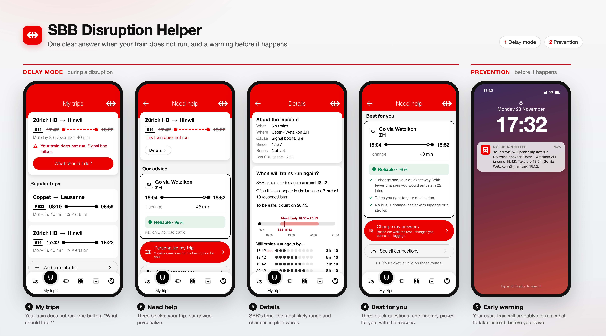

# SBB Disruption Helper

When a train line is cut, travellers get little information, late, and the
announced end keeps moving. **SBB Disruption Helper** is a "Need help" mode for
the SBB app that turns disruption data into the traveller's best next move: is
my train running, when will the line really reopen, what should *I* do now, and
it warns commuters before they even leave home.

LauzHack 2026, SBB challenge.

**Step-by-step guide to run and use it: [`GUIDE.md`](GUIDE.md).** Hackathon submission summary: [`SUBMISSION.md`](SUBMISSION.md). 
Backend: [`backend/README.md`](backend/README.md). Frontend: [`frontend/README.md`](frontend/README.md).



## The problem

We analysed the three SBB sources we were given (public liveticker, internal
KULT ticker, VIA event reports):

- **Late.** The first public message comes about **39 min** after the incident
  is created; staff know after about 3 min.
- **Optimistic.** The first announced end is too early in **68 %** of incidents,
  and it is moved several times (8–9 versions per incident on average).
- **Generic.** A message says what is broken, not what *this* traveller should
  do: wait, take another route, get off earlier, or not go to the station yet.

## What we built

| | What it does | How |
|---|---|---|
| **Honest reopening estimate** | Keeps SBB's time as the headline and adds a range and plain-word chances ("likely between 18:40 and 19:30") | Past incidents still ongoing after the same time, same cause: their gap between announced and real end. Back-tested on 2026 ([chart](docs/calibration-2026.png)): 17 % better than the announcement alone, calibrated |
| **One clear advice** | "Need help" shows one connection, with a reliability label and its % ("Reliable · 95%") | ~13 OJP 2.0 searches in parallel: detours, stations near the destination, replacement bus, waiting for the reopening |
| **Personalized** | 3 questions: where can you get off, what suits you best, what you travel with | A cost in minutes per option: arrival + weights for changes, replacement bus and uncertainty (formula in [`frontend/README.md`](frontend/README.md)) |
| **Commuter alerts** | From **3 h before** a regular trip, any interruption on its line sends an alert: will my train run, what to take instead | The estimate tells how likely the line is still closed when *my* train gets there |
| **Booked trips** | Warns when a trip paid in advance is hit, or a change becomes too tight | Live incidents, bus delays from road traffic (TomTom), usual delays at that hour |
| **SBB messages** | "Details" shows the official SBB messages (buses, detours, causes) as travellers saw them | Public liveticker messages, version by version |
| **Ticket validity** | "Your ticket is valid on these routes" on every option | SBB rules during disruptions |

## User journey

1. **My trips:** the 17:42 to Hinwil is marked "Your train does not run".
2. **What should I do?** → **Need help:** our advice, e.g. "Go via Wetzikon ZH, 18:04 → 18:52, Reliable · 99%".
3. **Personalize:** three taps; the advice changes (wait for the line, get off at Wetzikon and be picked up…).
4. **Details:** where, why, since when, when trains will probably run again, and SBB's own messages.
5. **Commuters:** a regular trip gets a notification on the lock screen hours before, with the advice inside.

## Run it

Needs Python 3.10+ and Node 18+. The data folder `Daten/` (provided by SBB, not
in git) goes at the repo root. From the repository root:

```bash
python3 -m venv backend/.venv && backend/.venv/bin/pip install -r backend/requirements.txt
npm --prefix frontend install
cp .env.example .env            # optional keys: OJP_API_KEY, TOMTOM_API_KEY
```

```bash
OJP_MODE=replay backend/.venv/bin/uvicorn app.main:app --app-dir backend --reload
```

```bash
npm --prefix frontend run dev
```

Open **http://localhost:5173**. `OJP_MODE=replay` runs offline from the recorded
OJP answers in `backend/data/ojp_recordings/` (no key needed). With an OJP key,
`OJP_MODE=auto` uses the recordings and calls OJP for anything new; `live`
always calls it. The replayed incident: `VITE_JOURNEY_ID=demo-1 npm --prefix frontend run dev`.

## Demo

The app runs in a phone frame. The **presenter panel** next to it (`D` hides it)
changes the live situation; everything in the app follows.

**Zürich HB → Hinwil, evening commute** (default, `demo-zh`). The S14 at 17:42 is
cut between Uster and Wetzikon ZH (simulated; its SBB messages come from the real
incident on that section of 11.06.2024).

| Presenter action | What the app says |
|---|---|
| Start (SBB: trains again ~18:42) | Take the S3 via Wetzikon, arriving 18:52 |
| Personalize (right at my destination, I accept anything), then publish "SBB expects trains again at 18:00" | Wait for your 17:42, arriving 18:22 |
| Personalize: "Further away, someone picks me up" | Get off at Bubikon or Wetzikon, earlier, and be picked up |
| "Replacement buses running" | The bus appears in "See all connections" and in the SBB messages of "Details" |
| Add a regular trip 17:42 | "Your 17:42 will probably not run", on the lock screen |
| "Line reopens now" | "Line reopened" |

**Coppet → Lausanne, morning commute.** Always in "My trips". Four buttons
(08:10 line closed, 09:11 end moved, 09:26 replacement buses, 11:04 line
reopened) show the notifications a commuter on the 08:19 RE33 would get, written
after the real incident Gland – Nyon of 5 March 2025.

**Lausanne → Bern, replay** (`demo-1`). The real fire Puidoux – Vauderens of
25.09.2026, replayed version by version with the internal KULT details.

"Reset the demo" starts again and removes the trips added during the demo.

## Real vs. simulated

| Part | State |
|---|---|
| Reopening estimate, back-test, probabilities | **Real**, on the provided data (523 incidents, 2024–2026) |
| Alternatives and timetables | **Real** OJP 2.0 answers (live, or recorded for offline replay) |
| Stations near the destination | **Real** SBB service points |
| SBB messages, KULT details, replayed incident (`demo-1`) | **Real** data |
| Zürich → Hinwil incident | **Simulated**, controlled by the presenter; messages from the real incident of 11.06.2024 |
| Coppet → Lausanne notifications | **Staged** by hand, after a real incident |
| Replacement bus times, bus delay forecast | **Real** TomTom traffic with a key; estimated without; jams can be simulated |
| Notifications | In-app and lock screen; real OS notifications in the browser; no server push |
| Users, trips, bookings | In memory, one demo user |

## Data

- `Daten/extern-liveticker/`: public liveticker, 523 incidents with every version and message (2024–2026).
- `Daten/intern-liveticker/`: internal KULT ticker, September 2026 (replacement buses, cancelled trains, ticket goodwill).
- `Daten/Ereignismeldungen/`: VIA event reports, September 2026 (lines affected, publication times).
- [OJP 2.0](https://opentransportdata.swiss) (opentransportdata.swiss): trip planning; SBB service points; TomTom traffic.

`Daten/` and `.env` are git-ignored: never commit them.

## Repository

```
.
├── backend/        FastAPI: estimation, routing (OJP), alerts, prevention, tests
├── frontend/       React app in a phone frame, presenter panel
├── docs/           demo-pitch.md (pitch and demo script), calibration chart, img/ (screenshots)
├── GUIDE.md        how to run and use the app, demo scenarios
├── SUBMISSION.md   short project summary for the submission
├── .env.example    settings (API keys, OJP mode)
└── Daten/          provided data (git-ignored)
```

## Tests

```bash
backend/.venv/bin/python -m pytest backend/tests
npm --prefix frontend run build
```

37 backend tests, offline: API, estimation on the real data, routing on the demo
journeys, commuter alerts, booked-trip checks. The frontend build type-checks the app.
