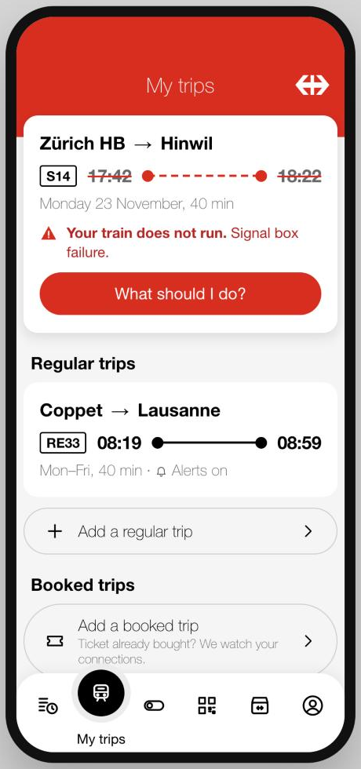
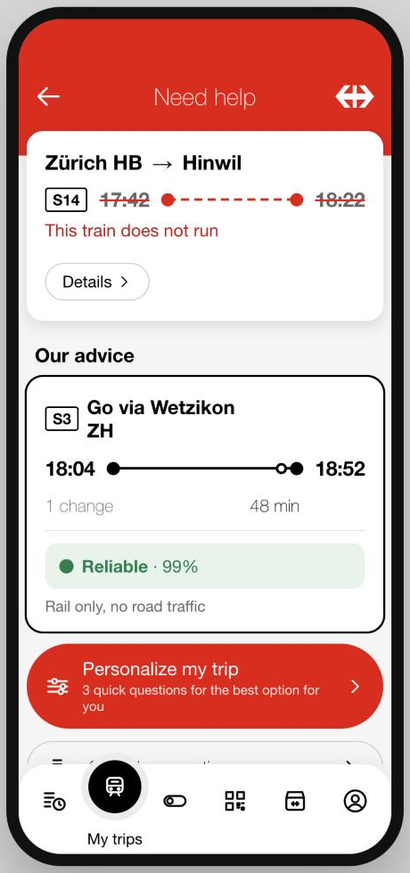
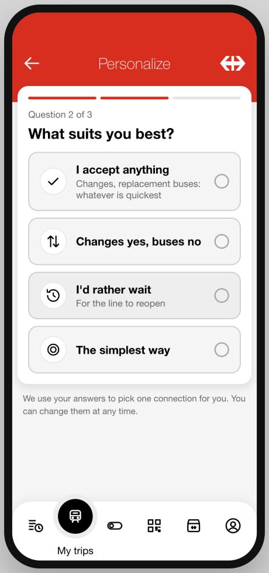
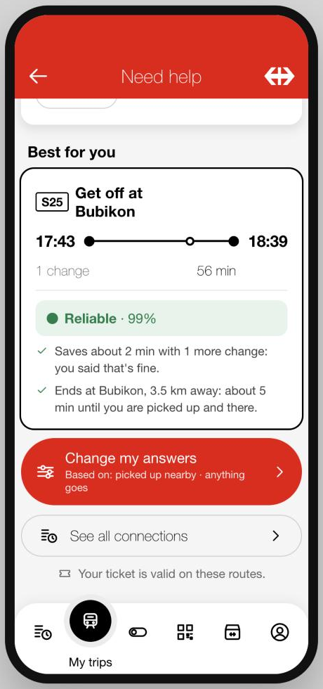
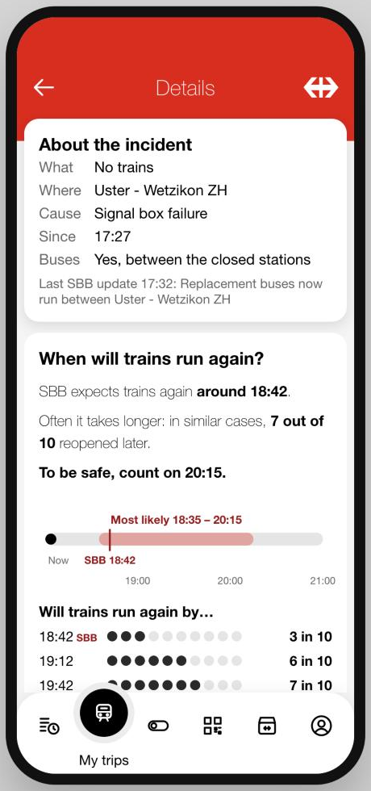
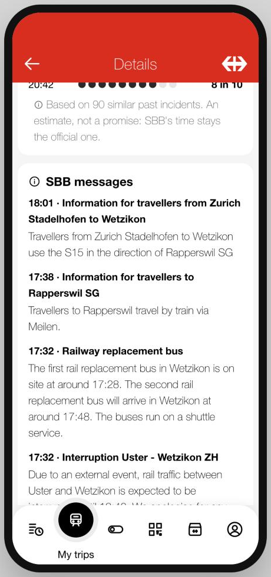
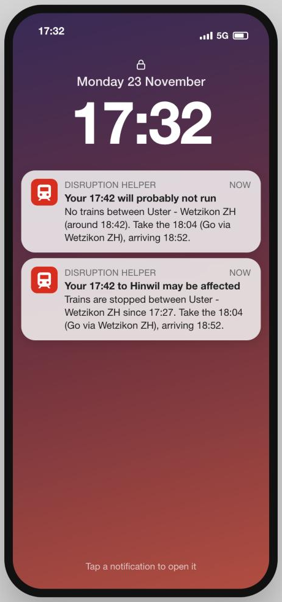
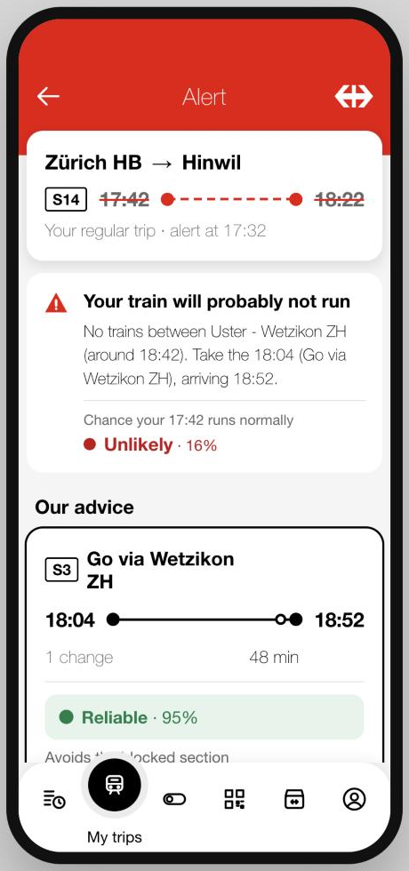

# SBB Disruption Helper: LauzHack 2026 submission

**Challenge:** SBB, *turn disruption data into the traveller's best next move*
**Repository:** https://github.com/SimeonBeguin/LauzHack-SBB
**Demo video:** _add link_
**Run it:** [`GUIDE.md`](GUIDE.md) (two commands, works offline)

## One line

A "Need help" mode for the SBB app: when your train does not run, it tells you
honestly when the line will probably reopen and gives you **one** clear advice
fitted to you (wait, take a detour, get off earlier, take the bus), and it warns
commuters up to 3 hours before they leave home.

## The problem

In the SBB data we were given, the first public message comes about **39 minutes**
after an incident starts (staff know after 3), the first announced end is **too
optimistic in 68 %** of incidents, and it is moved 8 to 9 times on average. The
messages say what is broken, not what *this* traveller should do, so people wait
on platforms for trains that will not come.

## What we built

| | |
|---|---|
| **Honest reopening estimate** | SBB's time stays the headline; we add a likely range and chances in plain words ("7 out of 10 reopened later"). Learned from past incidents still ongoing at the same point, with the same cause. Back-tested on 2026 without looking at the future: **17 % better** than the announcement alone, calibrated quantiles. |
| **One clear advice** | "Need help" shows one connection with a reliability label and its chance ("Reliable · 95%"). Behind it, about 13 OJP 2.0 searches in parallel: detours, stations near the destination, replacement bus timed with road traffic, and waiting for the reopening. |
| **Personalized in 3 taps** | Where can you get off · what suits you best · what you travel with. Each option gets a cost in minutes (arrival + weights for changes, replacement bus and uncertainty); the cheapest becomes "Best for you", with its reasons. |
| **Commuter alerts** | From 3 h before a regular trip, any interruption on its line sends a notification: will *my* train run (chance from the estimate at the time it reaches the section), and what to take instead. |
| **Booked trips** | Trips paid in advance (Supersaver) are watched from 3 h before: incidents, tight changes, and bus delays predicted from live traffic. |
| **Everything SBB knows, in one place** | "Details" gathers the official SBB messages as travellers saw them and, when available, internal information (replacement buses, cancelled trains, ticket goodwill), plus whether your ticket is valid on each route. |

## Screens

| My trips | Need help | Personalize | Best for you |
|---|---|---|---|
|  |  |  |  |

| Details | SBB messages | Lock screen | Commuter alert |
|---|---|---|---|
|  |  |  |  |

## Demo

The app runs in a phone frame with a presenter panel that changes the live
incident: **Zürich HB → Hinwil** in the evening (the advice changes when SBB
moves its end time, when replacement buses start, or when the traveller answers
the questions), **Coppet → Lausanne** in the morning (the notifications a
commuter would get, after the real incident Gland – Nyon of 5 March 2025), and
the real fire **Puidoux – Vauderens** of 25.09.2026 replayed version by version.

## Real vs. simulated

Real: the estimate and its back-test on the provided data (523 incidents,
2024–2026), OJP 2.0 timetables (live or recorded), SBB service points, SBB
messages and internal details, TomTom traffic when a key is set. Simulated for
the demo: the Zürich → Hinwil incident (driven by the presenter, with the
messages of the real incident on that section), the staged Coppet → Lausanne
notifications, and push notifications (in-app and browser only).

## Tech stack

Python · FastAPI · pandas · httpx (backend) · React 18 · TypeScript · Vite
(frontend) · OJP 2.0 and SBB service points (opentransportdata.swiss) · TomTom
Routing · SBB public liveticker, internal KULT ticker and VIA event reports ·
pytest. Offline mode replays recorded OJP answers.

## Proof it works

37 backend tests (pytest, offline): API, the estimate on the real data,
alternatives on the demo journeys, commuter alerts, booked-trip checks. The
frontend build type-checks the whole app. Estimation back-test:
`python -m app.estimation.evaluation` ([calibration chart](docs/calibration-2026.png)).

## Team

Olivier Küenzi, Ulysse du Sordet, Siméon Béguin
